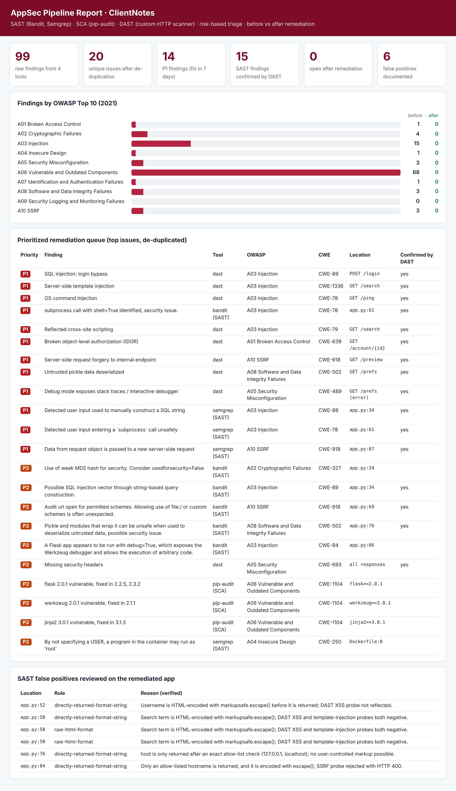

# AppSec Pipeline Lab: SAST · SCA · DAST · Container Security · Risk-Based Triage

[](https://github.com/nosheenfathima02-cmd/appsec-pipeline-lab/actions/workflows/appsec.yml)

An end-to-end **application security testing pipeline** run against a small banking-style web app, **ClientNotes**, which comes in two versions:

- `app_vulnerable/`: intentionally insecure, with one flaw for most of the OWASP Top 10 (2021). **Training only; never deploy.**
- `app_fixed/`: the remediated version, with each fix labelled in the code.

The pipeline scans both versions, merges the results into one **risk-prioritized** remediation queue, documents false positives, and blocks the release in CI if any P1 issue is open.



## Results (real output of `./run_all.sh` and the GitHub Actions run)

| | Vulnerable app | Remediated app |
|---|---|---|
| Raw findings (Bandit + Semgrep + pip-audit + DAST) | **99** | 6 |
| Unique issues after de-duplication | **20** (13 code weaknesses + 7 vulnerable packages) | 0 |
| P1 (fix in 7 days) / P2 / P3 | **14 / 47 / 38** | 0 |
| DAST-confirmed exploitable issues | **9** | 0 |
| SAST findings confirmed exploitable by DAST | **15** | n/a |
| Container misconfigurations (Trivy, in CI) | **4** (1 Critical, 1 High, 1 Medium, 1 Low) | 0 |
| False positives reviewed and documented | n/a | **6** |
| CI security gate | fails (blocks the release) | passes |

**Key takeaways**
- The **IDOR** (Alice can read Bob's account) was found **only by DAST**. SAST tools cannot see missing authorization logic.
- **68 of 99 findings were dependency CVEs** (A06) in 7 packages, all fixed by upgrading. Counting findings alone would have pointed the team at the wrong work.
- Semgrep flagged 6 lines in the fixed app. Each was reviewed, confirmed safe (output encoding or an allow-list), verified with DAST, and recorded with a reason in `triage/suppressions.json`.

## Pipeline

| Stage | Tool | What it checks |
|---|---|---|
| SAST | Bandit, Semgrep (`p/python`, `p/flask`, `p/owasp-top-ten`, `p/dockerfile`) | Insecure code patterns, Dockerfile misconfiguration |
| SCA | pip-audit | Known CVEs in dependencies |
| DAST | `dast/dast_scan.py` | Starts the app and attacks it over HTTP with safe payloads: SQL injection login bypass, XSS, template injection, IDOR, command injection, SSRF, insecure deserialization, debug mode, security headers |
| Container security | Trivy (in CI), Semgrep Dockerfile rules | Unpinned base image, root user, secrets baked into the image |
| Triage | `triage/triage.py` | Normalizes all results; maps each to OWASP Top 10 and CWE; risk = severity + 2.5 if exploitation is confirmed by DAST; P1 = fix in 7 days, P2 = 30 days, P3 = 90 days |
| Gate | GitHub Actions | Fails the build when any P1 is open |

## Run it

```bash
pip install bandit semgrep pip-audit flask
./run_all.sh                          # SAST -> SCA -> DAST -> triage -> reports/appsec_report.html
python -m unittest discover -s tests  # 9 security regression tests
```

The CI/CD pipeline is in `.github/workflows/appsec.yml` and runs both versions on every push.

## Developer training

`docs/secure-coding-guide.md` is a one-page handout for development teams. It covers 12 vulnerable patterns found in this lab, the secure fix for each, and which tool catches it.

## Layout

```
app_vulnerable/   insecure app, old dependency pins, weak Dockerfile
app_fixed/        remediated app, patched dependencies, hardened Dockerfile
dast/             DAST scanner (safe payloads, localhost only)
triage/           risk-based triage, false-positive suppressions, HTML report
tests/            9 security regression tests (each exploit works on the vulnerable app and is blocked on the fixed one)
reports/          scanner outputs (JSON) and the HTML report
docs/             report screenshot and secure coding guide
.github/workflows CI/CD security pipeline
```

## Author

Nousheen Fathima. Copyright, all rights reserved (see LICENSE).
